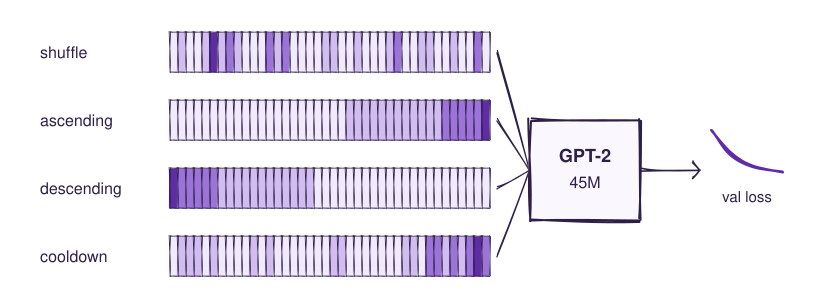

# GPT-2 curriculum learning on FineWeb-Edu

Does the order in which a language model sees its training documents change what it learns?

We trained four small GPT-2 models (45M parameters) from scratch on the same 900M tokens of [FineWeb-Edu](https://huggingface.co/datasets/HuggingFaceFW/fineweb-edu). They differ only in the order of the documents, which is set by each document's educational score. Each order was trained with six seeds (42 to 47).

- **Model and data:** [NoeFlandre/gpt2-fineweb-edu-curriculum-learning](https://huggingface.co/NoeFlandre/gpt2-fineweb-edu-curriculum-learning) on the Hugging Face Hub
- **Training dashboard:** [Trackio dashboard](https://huggingface.co/spaces/NoeFlandre/gpt2-fineweb-edu-curriculum-learning)
- **Method and limitations:** [docs/experiment.md](docs/experiment.md)

## Results

Final checkpoint after 1,716 steps (899.7M tokens), as mean ± standard deviation over the six seeds. Validation loss is in nats per token, so lower is better. Benchmarks are normalized accuracy, in percent. Bold marks the best mean in each column.

| Order | Val loss | [2.5, 3) | [3, 3.5) | [3.5, 4) | [4, 5] | HellaSwag | PIQA | ARC-Easy |
|---|---|---|---|---|---|---|---|---|
| `shuffle` | 4.013 ± 0.006 | 4.141 ± 0.007 | **4.035 ± 0.007** | 3.976 ± 0.006 | 3.900 ± 0.006 | **25.5 ± 0.2** | **56.1 ± 0.6** | **34.2 ± 1.2** |
| `ascending` | 4.022 ± 0.008 | 4.183 ± 0.007 | 4.055 ± 0.008 | 3.972 ± 0.008 | **3.876 ± 0.007** | 25.1 ± 0.3 | 55.5 ± 0.6 | 33.1 ± 0.5 |
| `descending` | 4.036 ± 0.013 | **4.130 ± 0.013** | 4.046 ± 0.013 | 4.012 ± 0.013 | 3.957 ± 0.012 | 25.3 ± 0.1 | 55.9 ± 0.3 | 33.1 ± 0.6 |
| `cooldown` | **4.010 ± 0.010** | 4.156 ± 0.010 | 4.038 ± 0.010 | **3.967 ± 0.009** | 3.881 ± 0.010 | 25.1 ± 0.2 | 55.9 ± 0.3 | 33.9 ± 0.4 |

Validation loss per seed:

| Order | 42 | 43 | 44 | 45 | 46 | 47 | Mean |
|---|---|---|---|---|---|---|---|
| `shuffle` | 4.004 | 4.013 | 4.013 | 4.010 | 4.014 | 4.024 | 4.013 |
| `ascending` | 4.022 | 4.036 | 4.013 | 4.017 | 4.020 | 4.020 | 4.022 |
| `descending` | 4.039 | 4.012 | 4.036 | 4.037 | 4.044 | 4.048 | 4.036 |
| `cooldown` | 4.010 | 4.003 | 4.030 | 4.007 | 4.007 | 4.006 | 4.010 |

- **Cooldown and shuffle are tied for the lowest mean validation loss** (4.010 and 4.013). Cooldown is lower in four seeds and shuffle in two, which is within seed-to-seed noise.
- **Shuffle beats descending in five of six seeds** (mean difference 0.023 nats) and ascending in five (0.009 nats).
- **Descending has the highest loss in five of six seeds.**
- **The benchmarks are close to chance** for all four orders, and their differences are within seed noise.

## The four orders

| Order | Document order |
|---|---|
| `shuffle` | Random |
| `ascending` | Lowest score first |
| `descending` | Highest score first |
| `cooldown` | Lowest-scoring 80% of tokens (shuffled), then the highest-scoring 20% (shuffled) |

All four share the same tokens, model, optimizer and schedule. The loss is the plain mean, so only the order differs.

## Setup

- **Model:** GPT-2 with 6 layers, width 512, 8 heads, context 1,024 and tied embeddings (about 45M parameters)
- **Budget:** 900M tokens per arm, 524,288 tokens per step
- **Pool:** a shuffled slice of FineWeb-Edu `sample-10BT`, about 1.3 of its 14 files. Every document scores at least 2.5.
- **Seeds:** 42 to 47. The seed sets the model initialization only. The data seed is 42: the orders and the pools come from it, and the validation split is the same for every run.
- **Validation leakage:** 16 validation documents had leaked into the seed-42 pool, so all earlier results were withdrawn and all 24 runs were retrained on the corrected setup.
- **Primary metric:** validation loss on 2M held-out tokens, reported overall and per score bucket
- **Benchmarks:** HellaSwag, PIQA and ARC-Easy, every 50 steps

Full details, including the score mix of the pool and the cooldown split, are in [docs/experiment.md](docs/experiment.md).

## Quick start

```bash
uv sync
uv run pytest
bash scripts/run_experiment.sh   # needs a CUDA GPU and a Hugging Face token with write access
```

`SEED=43 bash scripts/run_experiment.sh` trains another seed; `DATA_SEED=43` draws another data sample. Both default to 42. Each run goes to `runs/init<N>-data<D>/`, where `<N>` is the initialization seed and `<D>` the data seed.

The steps can also be run one at a time: `scripts/prepare_data.py`, `scripts/prepare_benchmarks.py`, `scripts/train.py --arm <name>`, `scripts/report.py` and `scripts/upload.py`. See [docs/usage.md](docs/usage.md).

To run the study on Grid'5000 instead (one GPU per arm, through the `abaca` or `besteffort` queue), see [docs/grid5000.md](docs/grid5000.md).

## Repository

- `gpt2_scratch/`: model, data, orders, evaluation, training and tracking
- `scripts/`: entry points; `scripts/g5k/` runs the study on Grid'5000
- `tests/`: test suite
- `docs/`: method, usage and architecture
- `data/benchmarks/`: HellaSwag, PIQA and ARC-Easy examples

## Requirements

Python 3.12, [uv](https://docs.astral.sh/uv/), and a CUDA GPU with 16 GB of memory. All 24 runs ran on Grid'5000, on NVIDIA L40S and RTX A5000 GPUs.

## Acknowledgements

The GPT-2 implementation follows Andrej Karpathy's [Let's reproduce GPT-2 (124M)](https://youtu.be/l8pRSuU81PU). The training data is [FineWeb-Edu](https://huggingface.co/datasets/HuggingFaceFW/fineweb-edu), and the scores come from its educational classifier.

## License

MIT. See [LICENSE](LICENSE).
